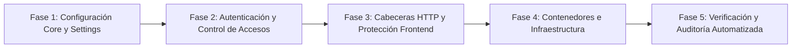

# PLAN DE IMPLEMENTACIÓN — HARDENING Y CIBERSEGURIDAD
## GastuDjango / GastuApp

> **Objetivo:** Blindar integralmente la plataforma contra ataques comunes (fuerza bruta, secuestro de sesión, XSS, CSRF, Open Redirect, robo de credenciales, inyección e IDOR) y elevar la postura de seguridad a estándares empresariales sin degradar la experiencia de usuario.
> **Ubicación:** Raíz del proyecto (`PLAN_HARDENING.md`). Documento temporal, eliminable tras completar el ciclo de implementación.

---

## 1. Diagnóstico de Vulnerabilidades y Brechas Detectadas

A partir de la auditoría técnica exhaustiva realizada al código fuente, se identificaron los siguientes hallazgos clasificados por severidad:

### 🔴 Críticas (Atención Inmediata)
1. **Fallback inseguro de `SECRET_KEY` y `DEBUG`:**
   - En `gastu_django/settings.py`, si la variable de entorno falta, se usa una clave fija (`django-insecure-sr^8%...`) y `DEBUG` se evalúa como `True` por defecto.
2. **Exposición de Credenciales Reales en Entorno Local:**
   - El archivo local `.env` contiene credenciales sensibles en texto plano (base de datos Supabase de producción, Groq API Key, App Password de Gmail, contraseñas de superusuario).
3. **Cookies de Sesión y CSRF sin Flags de Seguridad:**
   - Ausencia explícita de `SESSION_COOKIE_SECURE`, `CSRF_COOKIE_SECURE`, `SESSION_COOKIE_HTTPONLY`, permitiendo tráfico de cookies sobre HTTP no cifrado.
4. **Vulnerabilidad de Redirección Abierta (Open Redirect):**
   - En `usuarios/views.py` (`login_view`), el parámetro `next` no es validado con `url_has_allowed_host_and_scheme()`, lo que permite ataques de phishing redirigiendo a sitios maliciosos tras iniciar sesión.
5. **Endpoints y Vistas sin Autenticación (`@login_required` ausente):**
   - `agente_financiero/views.py:agente_financiero` (renderiza interfaz del chat sin requerir sesión activa).
   - `programaciones/views.py:base_programaciones` (renderiza interfaz de programaciones sin auth).
   - `categorias/api_views.py:categorias_egreso` (carece de control de permisos en endpoint DRF).
6. **Configuración Global por Defecto de Django Rest Framework (DRF):**
   - No hay bloque `REST_FRAMEWORK` en `settings.py`. DRF asume `AllowAny` por defecto para endpoints que no definan explícitamente `permission_classes`.
7. **Contenedor Docker ejecutado como `root`:**
   - `Dockerfile` no cuenta con usuario sin privilegios (`non-root user`), aumentando el radio de impacto en caso de Remote Code Execution (RCE).

### 🟠 Altas (Fortalecimiento Estructural)
1. **Protección insuficiente contra Fuerza Bruta:**
   - Actualmente el rate limiting solo está en `login_view` con IP estática (`5/m`). No hay control por nombre de usuario (ataques distribuidos) ni en `register_view` (creación masiva de cuentas bots).
   - Falta bloqueo progresivo temporal con registro de auditoría (`django-axes`).
2. **Logout susceptible a CSRF:**
   - `logout_view` permite peticiones `GET`, facilitando que sitios externos desautentiquen al usuario mediante etiquetas `` o enlaces trampa. Debe ser estrictamente `POST`.
3. **Ausencia de Cabeceras HTTP de Seguridad (HSTS, CSP, X-Content-Type):**
   - Faltan `SECURE_HSTS_SECONDS`, `SECURE_CONTENT_TYPE_NOSNIFF`, `SECURE_BROWSER_XSS_FILTER` y Content Security Policy (`django-csp` o meta/nginx).
4. **Dependencias Frontend sin Integridad (SRI) y Versiones Flotantes:**
   - `base_app.html` utiliza `unpkg.com/lucide@latest` (etiqueta `@latest` flotante sin pinning de versión ni hash SRI).

### 🟡 Medias (Buenas Prácticas Operativas)
1. Fuga de detalles de excepciones internas en respuestas de eliminación de cuenta (`str(e)` expuesto al frontend).
2. Falta de política estricta de caducidad de sesiones inactivas (`SESSION_COOKIE_AGE`).
3. Ausencia de verificación de integridad y control de subida de archivos (cuando se importan CSVs masivos).

---

## 2. Fases del Plan de Implementación



---

### Fase 1: Configuración Core y Blindaje de `settings.py`

#### 1.1 Saneamiento de `SECRET_KEY`, `DEBUG` y `ALLOWED_HOSTS`
- Modificar `settings.py` para que en entornos que no sean de desarrollo local explícito, la ausencia de `SECRET_KEY` o una clave con prefijo `django-insecure-` lance una excepción crítica (`ImproperlyConfigured`).
- Establecer `DEBUG = os.getenv('DEBUG', 'False').lower() in ('true', '1')` (por defecto `False` si no se declara).
- Depurar `ALLOWED_HOSTS` eliminando IPs duras innecesarias o comodines no controlados.

#### 1.2 Políticas Estrictas de Cookies y Sesiones
- Añadir flags condicionales en producción (`if not DEBUG:`):
  ```python
  SESSION_COOKIE_SECURE = True
  CSRF_COOKIE_SECURE = True
  SESSION_COOKIE_HTTPONLY = True
  CSRF_COOKIE_HTTPONLY = True
  SESSION_COOKIE_SAMESITE = 'Lax'
  CSRF_COOKIE_SAMESITE = 'Lax'
  SESSION_EXPIRE_AT_BROWSER_CLOSE = True
  SESSION_COOKIE_AGE = 60 * 60 * 4  # 4 horas de inactividad
  ```

#### 1.3 Configuración Base de Django Rest Framework
- Agregar bloque global a `settings.py`:
  ```python
  REST_FRAMEWORK = {
      'DEFAULT_PERMISSION_CLASSES': [
          'rest_framework.permissions.IsAuthenticated',
      ],
      'DEFAULT_AUTHENTICATION_CLASSES': [
          'rest_framework.authentication.SessionAuthentication',
      ],
  }
  ```

---

### Fase 2: Autenticación, Rate Limiting y Protección contra Fuerza Bruta

#### 2.1 Mitigación de Open Redirect en Login
- En `usuarios/views.py:login_view`:
  - Utilizar `django.utils.http.url_has_allowed_host_and_scheme(url=next_url, allowed_hosts={request.get_host()})`.
  - Si no es segura, redirigir invariablemente a `settings.LOGIN_REDIRECT_URL` (`dashboard:home`).

#### 2.2 Blindaje de Logout
- Cambiar `logout_view` para exigir método `POST` y token CSRF.
- Actualizar los botones o formularios de salida en `base_app.html` y `base_admin.html` para enviar formularios POST.

#### 2.3 Protección contra Fuerza Bruta Avanzada (Axes / Ratelimit)
- Aplicar rate limiting estricto en:
  - `login_view`: Control combinado por IP y por username (`rate='5/m'`).
  - `register_view`: Control por IP (`rate='3/h'`) para evitar bots de registro masivo.
  - Endpoints de envío de tokens o recuperación de contraseñas.
- Integrar `django-axes` para registrar en base de datos cada intento fallido, bloqueando temporalmente IPs/usuarios reincidentes (con posibilidad de desbloqueo desde el panel de administración).

#### 2.4 Cierre de Brechas de Acceso (Vistas Huérfanas)
- Decorar con `@login_required` o `@permission_classes([IsAuthenticated])`:
  - `agente_financiero/views.py:agente_financiero`
  - `programaciones/views.py:base_programaciones`
  - `categorias/api_views.py:categorias_egreso`
- Auditar y sanitizar mensajes de excepción para que retornen mensajes genéricos al usuario ("Ocurrió un error al procesar la solicitud") mientras se registra el stack trace detallado en los logs internos del servidor.

---

### Fase 3: Cabeceras HTTP, Inyección y Frontend (CSP & SRI)

#### 3.1 Cabeceras de Seguridad del Servidor (Security Headers)
- En `settings.py`:
  ```python
  SECURE_BROWSER_XSS_FILTER = True
  SECURE_CONTENT_TYPE_NOSNIFF = True
  X_FRAME_OPTIONS = 'DENY'
  SECURE_REFERRER_POLICY = 'same-origin'
  ```
- En producción HTTPS:
  ```python
  SECURE_SSL_REDIRECT = True
  SECURE_HSTS_SECONDS = 31536000  # 1 año
  SECURE_HSTS_INCLUDE_SUBDOMAINS = True
  SECURE_HSTS_PRELOAD = True
  ```

#### 3.2 Content Security Policy (CSP) & Subresource Integrity (SRI)
- Fijar versiones exactas de scripts externos en `templates/base_app.html`:
  - Cambiar `unpkg.com/lucide@latest` a versión fija (ej. `lucide@0.460.0`) con atributo `integrity="sha384-..."` y `crossorigin="anonymous"`.
  - Mismo procedimiento para `SweetAlert2` y `driver.js`.
- Configurar cabecera CSP básica permitiendo únicamente orígenes de confianza (self, CDNs aprobados, scripts de gráficos y WebSockets del dominio).

#### 3.3 Validación de Cargas Masivas (CSV/Excel)
- Implementar validación estricta de extensiones, tipos MIME (`text/csv`, `application/vnd.ms-excel`), tamaño máximo (ej. 2MB) y desinfección de fórmulas (evitar CSV Formula Injection `=CMD|...` anteponiendo comillas si un campo inicia con `=`, `+`, `-` o `@`).

---

### Fase 4: Despliegue, Contenedores y Gestión de Secretos

#### 4.1 Hardening de Dockerfile
- Crear usuario y grupo sin privilegios en el contenedor:
  ```dockerfile
  RUN addgroup --system gastu && adduser --system --group gastu
  USER gastu
  ```
- Asegurar que `.dockerignore` excluya taxativamente `.env`, `.git`, `db.sqlite3`, `tests/` y artefactos de desarrollo.

#### 4.2 Configuración Segura de Nginx y Redis
- En `deploy/nginx/default.conf`:
  - Agregar cabeceras `add_header X-Frame-Options "DENY" always;`, `add_header X-Content-Type-Options "nosniff" always;`, `add_header Referrer-Policy "strict-origin-when-cross-origin" always;`.
  - Forzar protocolo TLS 1.3/1.2 estricto.
- Proteger Redis asignando contraseña obligatoria mediante variable de entorno (`requirepass`).

---

## 3. Plan de Pruebas y Criterios de Aceptación (DoD)

Para dar por finalizado el hardening, se deberán superar las siguientes validaciones:

1. **Test de Intrusión Automatizado / Auditoría Django:**
   - Ejecución de `python manage.py check --deploy`: Cero advertencias críticas o de seguridad en configuración de producción.
2. **Pruebas de Inyección y Fuerza Bruta:**
   - Intentos sucesivos de login deben retornar HTTP 429 (Too Many Requests) o bloqueo de cuenta según la política.
   - Peticiones con `next=https://sitio-malicioso.com` deben ser neutralizadas y redirigir a `/dashboard/`.
3. **Pruebas de Acceso No Autenticado:**
   - Intentos directos de GET a `/agente_financiero/`, `/programaciones/` y APIs deben responder con redirección a login (302) o HTTP 401/403.
4. **Verificación de Headers:**
   - Inspección con `curl -I` o herramientas web (SecurityHeaders.com) certificando la presencia de HSTS, X-Content-Type-Options y X-Frame-Options.

